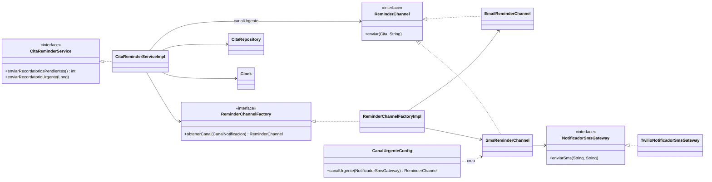
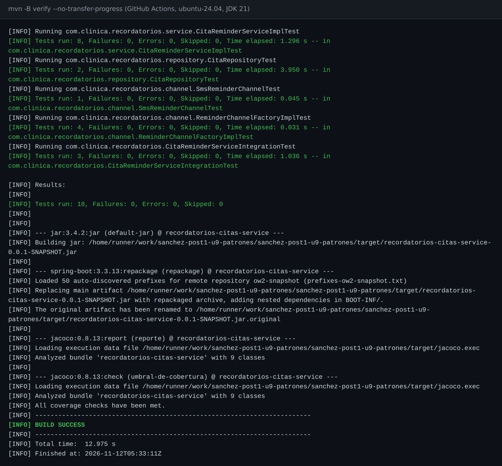
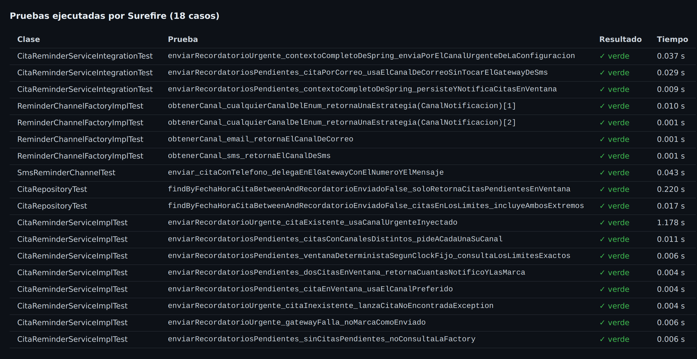
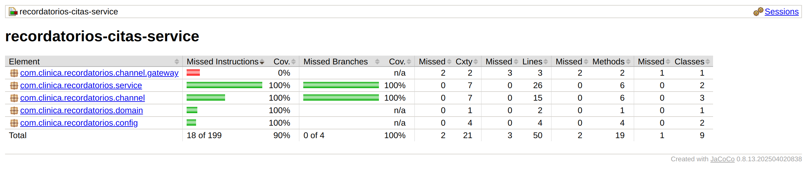
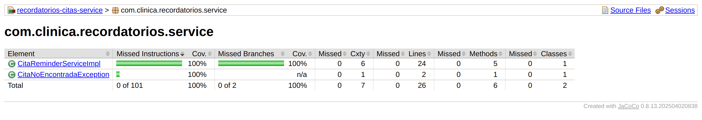
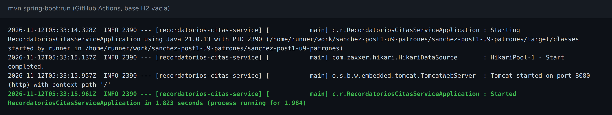
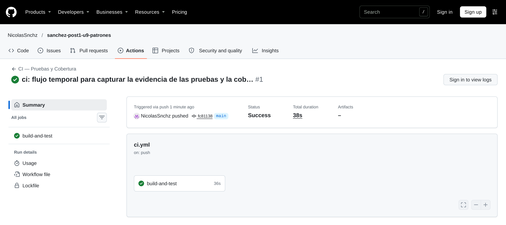

# Recordatorios Citas Service

[](https://github.com/NicolasSnchz/sanchez-post1-u9-patrones/actions/workflows/ci.yml)

## Descripción

Post-contenido de la unidad 9 de Patrones de Diseño de Software (UDES). Nicolás Andrés Sánchez Villamizar.

Microservicio en Spring Boot que busca las citas médicas de las próximas 24 horas que todavía no tienen recordatorio y se lo envía al paciente por su canal preferido, correo o SMS. El servicio nace con **Strategy** (`ReminderChannel`) y **Factory Method** (`ReminderChannelFactory`) inyectados por constructor junto con un `Clock`, aplicando el Principio de Inversión de Dependencias desde el inicio. En la Parte 2 se agrega un recordatorio urgente que nace violando ese principio: primero se diagnostica por qué no se puede probar, después se refactoriza y solo entonces se prueba, se integra con H2 y se automatiza en GitHub Actions.



Las cuatro flechas que salen de `CitaReminderServiceImpl` llegan a interfaces o a `Clock`, y todas entran por el constructor. Esos cuatro puntos son exactamente donde una prueba puede entregar un doble.

## Parte 1: pruebas unitarias con JUnit 5 y Mockito

[`CitaReminderServiceImplTest`](https://github.com/NicolasSnchz/sanchez-post1-u9-patrones/blob/main/src/test/java/com/clinica/recordatorios/service/CitaReminderServiceImplTest.java) aísla `CitaReminderServiceImpl` de sus colaboradores sin levantar Spring: el servicio se construye a mano en `@BeforeEach` con los mocks de Mockito y un reloj fijo ([línea 52](https://github.com/NicolasSnchz/sanchez-post1-u9-patrones/blob/main/src/test/java/com/clinica/recordatorios/service/CitaReminderServiceImplTest.java#L52)).

```java
// Fake: deliberadamente NO se mockea con Mockito. Clock.fixed(...) es una implementacion
// real y completa de java.time.Clock, solo que con el instante congelado.
private final Clock clockFijo =
    Clock.fixed(Instant.parse("2026-08-10T09:00:00Z"), ZoneId.of("UTC"));
```

| Prueba | Qué comprueba |
|---|---|
| `enviarRecordatoriosPendientes_citaEnVentana_usaElCanalPreferido` ([línea 58](https://github.com/NicolasSnchz/sanchez-post1-u9-patrones/blob/main/src/test/java/com/clinica/recordatorios/service/CitaReminderServiceImplTest.java#L58)) | La cita por correo sale por el canal que entrega la fábrica, se guarda una vez y queda marcada como enviada. |
| `enviarRecordatoriosPendientes_dosCitasEnVentana_retornaCuantasNotificoYLasMarca` ([línea 76](https://github.com/NicolasSnchz/sanchez-post1-u9-patrones/blob/main/src/test/java/com/clinica/recordatorios/service/CitaReminderServiceImplTest.java#L76)) | Con dos citas, el método devuelve 2 y las dos quedan marcadas. Es la única prueba que usa los colaboradores como stubs: no verifica ninguna llamada, solo el resultado. |
| `enviarRecordatoriosPendientes_citasConCanalesDistintos_pideACadaUnaSuCanal` ([línea 95](https://github.com/NicolasSnchz/sanchez-post1-u9-patrones/blob/main/src/test/java/com/clinica/recordatorios/service/CitaReminderServiceImplTest.java#L95)) | Con una cita por correo y otra por SMS, el servicio le pide a la fábrica cada canal y cada uno recibe su mensaje exacto, con la fecha de su cita. |
| `enviarRecordatoriosPendientes_ventanaDeterministaSegunClockFijo_consultaLosLimitesExactos` ([línea 117](https://github.com/NicolasSnchz/sanchez-post1-u9-patrones/blob/main/src/test/java/com/clinica/recordatorios/service/CitaReminderServiceImplTest.java#L117)) | Con el reloj fijo, la consulta va exactamente del 10 de agosto a las 9:00 al 11 de agosto a las 9:00. Con el reloj del sistema esta aserción cambiaría en cada ejecución. |
| `enviarRecordatoriosPendientes_sinCitasPendientes_noConsultaLaFactory` ([línea 135](https://github.com/NicolasSnchz/sanchez-post1-u9-patrones/blob/main/src/test/java/com/clinica/recordatorios/service/CitaReminderServiceImplTest.java#L135)) | Sin citas no se toca la fábrica ni se guarda nada. |

Los canales tienen además sus propias pruebas en el paquete `channel`, que refleja el de la aplicación: [`ReminderChannelFactoryImplTest`](https://github.com/NicolasSnchz/sanchez-post1-u9-patrones/blob/main/src/test/java/com/clinica/recordatorios/channel/ReminderChannelFactoryImplTest.java) comprueba que la fábrica entrega la estrategia correcta para cada valor del enum, y [`SmsReminderChannelTest`](https://github.com/NicolasSnchz/sanchez-post1-u9-patrones/blob/main/src/test/java/com/clinica/recordatorios/channel/SmsReminderChannelTest.java) que el canal SMS le pasa al gateway el número y el mensaje.

## Parte 2: refactor DIP, integración y CI/CD

### Diagnóstico antes del refactor

La primera versión de `enviarRecordatorioUrgente(Long citaId)` funcionaba, pero no se podía probar en aislamiento. La línea responsable era esta (https://github.com/NicolasSnchz/sanchez-post1-u9-patrones/blob/e12bb1110c88a10e60c0cf2aa512c793e968b866/src/main/java/com/clinica/recordatorios/service/CitaReminderServiceImpl.java#L52):

```java
ReminderChannel canalUrgente = new SmsReminderChannel(new TwilioNotificadorSmsGateway());
```

El canal y el gateway se construían con `new` dentro del método, así que la prueba no tenía ningún punto donde entregar un doble: no había forma de simular que el proveedor de SMS falla para comprobar que la cita no queda marcada como enviada, y cada ejecución intentaría mandar un SMS de verdad. `enviarRecordatoriosPendientes()` sí se podía probar desde la Parte 1 porque recibe la fábrica por constructor y el canal sale de ella, no de un `new`. Se podría interceptar ese `new` con `Mockito.mockConstruction()`, pero eso esconde el problema de diseño en vez de resolverlo.

Este diagnóstico lo escribí antes de tocar el código, como pide el punto de decisión del Paso 7: está en el [README del commit `e12bb11`](https://github.com/NicolasSnchz/sanchez-post1-u9-patrones/blob/e12bb1110c88a10e60c0cf2aa512c793e968b866/README.md#parte-2-diagnóstico-antes-del-refactor), el mismo commit que agrega la versión con el `new`.

### El refactor: antes y después

El `new` no desaparece, porque alguien tiene que construir el objeto concreto. Lo que cambia es dónde vive: se mudó al único lugar donde corresponde, la configuración de Spring.

**Antes** (commit [`e12bb11`](https://github.com/NicolasSnchz/sanchez-post1-u9-patrones/commit/e12bb1110c88a10e60c0cf2aa512c793e968b866)): el servicio construye su propio canal.

```java
@Override
public void enviarRecordatorioUrgente(Long citaId) {
    Cita cita = citaRepository.findById(citaId)
        .orElseThrow(() -> new CitaNoEncontradaException(citaId));

    ReminderChannel canalUrgente = new SmsReminderChannel(new TwilioNotificadorSmsGateway());
    canalUrgente.enviar(cita, "URGENTE: su cita es en menos de 2 horas y no ha sido confirmada");

    cita.setRecordatorioEnviado(true);
    citaRepository.save(cita);
}
```

**Después** (commit [`a757665`](https://github.com/NicolasSnchz/sanchez-post1-u9-patrones/commit/a7576658c5c8be78e349d4d86ac5528f9f342afb)): la construcción vive en `CanalUrgenteConfig` ([línea 15](https://github.com/NicolasSnchz/sanchez-post1-u9-patrones/blob/main/src/main/java/com/clinica/recordatorios/config/CanalUrgenteConfig.java#L15)) y el servicio recibe la abstracción por constructor ([línea 24](https://github.com/NicolasSnchz/sanchez-post1-u9-patrones/blob/main/src/main/java/com/clinica/recordatorios/service/CitaReminderServiceImpl.java#L24)).

```java
@Configuration
public class CanalUrgenteConfig {
    @Bean
    public ReminderChannel canalUrgente(NotificadorSmsGateway gateway) {
        return new SmsReminderChannel(gateway);
    }
}
```

```java
public CitaReminderServiceImpl(CitaRepository citaRepository,
                               ReminderChannelFactory reminderChannelFactory,
                               @Qualifier("canalUrgente") ReminderChannel canalUrgente,
                               Clock clock) { ... }

@Override
public void enviarRecordatorioUrgente(Long citaId) {
    Cita cita = citaRepository.findById(citaId)
        .orElseThrow(() -> new CitaNoEncontradaException(citaId));

    canalUrgente.enviar(cita, "URGENTE: su cita es en menos de 2 horas y no ha sido confirmada");
    cita.setRecordatorioEnviado(true);
    citaRepository.save(cita);
}
```

| | Antes | Después |
|---|---|---|
| Quién construye el canal urgente | El propio método, en cada llamada | `CanalUrgenteConfig.canalUrgente(gateway)`, en el paquete `config` |
| Cómo llega al servicio | No llega: se crea adentro | Por constructor, como `ReminderChannel` |
| ¿Se puede probar con Mockito? | No: no hay punto de sustitución | Sí: la prueba entrega un `@Mock ReminderChannel` |
| Qué hace con la cita | Envía el mensaje urgente por SMS y la marca como enviada | Exactamente lo mismo: el refactor no cambió el comportamiento |

**Por qué hace falta el `@Qualifier`.** Después del refactor hay tres beans de tipo `ReminderChannel` en el contexto: `emailReminderChannel`, `smsReminderChannel` y `canalUrgente`. Sin el `@Qualifier("canalUrgente")`, Spring no sabría cuál inyectar en el servicio. El checkpoint del Paso 3 («`ReminderChannel` tiene exactamente dos implementaciones») sigue siendo cierto: `canalUrgente` no es una tercera clase, es otra instancia de `SmsReminderChannel` creada en la configuración.

Las tres pruebas que el refactor hizo posibles:

| Prueba | Qué comprueba |
|---|---|
| `enviarRecordatorioUrgente_citaExistente_usaCanalUrgenteInyectado` ([línea 147](https://github.com/NicolasSnchz/sanchez-post1-u9-patrones/blob/main/src/test/java/com/clinica/recordatorios/service/CitaReminderServiceImplTest.java#L147)) | El mensaje con «URGENTE» sale por el canal inyectado y la cita se guarda marcada. |
| `enviarRecordatorioUrgente_gatewayFalla_noMarcaComoEnviado` ([línea 160](https://github.com/NicolasSnchz/sanchez-post1-u9-patrones/blob/main/src/test/java/com/clinica/recordatorios/service/CitaReminderServiceImplTest.java#L160)) | Si el envío falla, la excepción sube, no se guarda nada y la cita sigue sin marcar. Esta prueba era imposible antes del refactor. |
| `enviarRecordatorioUrgente_citaInexistente_lanzaCitaNoEncontradaException` ([línea 178](https://github.com/NicolasSnchz/sanchez-post1-u9-patrones/blob/main/src/test/java/com/clinica/recordatorios/service/CitaReminderServiceImplTest.java#L178)) | Con un id que no existe se lanza `CitaNoEncontradaException` con su mensaje y el canal no se toca. |

### Pruebas de integración con H2

[`CitaRepositoryTest`](https://github.com/NicolasSnchz/sanchez-post1-u9-patrones/blob/main/src/test/java/com/clinica/recordatorios/repository/CitaRepositoryTest.java) usa `@DataJpaTest`, que levanta H2 en memoria sin ninguna configuración: [`application.properties`](https://github.com/NicolasSnchz/sanchez-post1-u9-patrones/blob/main/src/main/resources/application.properties) no define ningún datasource.

| Prueba | Qué comprueba |
|---|---|
| `findByFechaHoraCitaBetweenAndRecordatorioEnviadoFalse_soloRetornaCitasPendientesEnVentana` ([línea 23](https://github.com/NicolasSnchz/sanchez-post1-u9-patrones/blob/main/src/test/java/com/clinica/recordatorios/repository/CitaRepositoryTest.java#L23)) | De tres citas devuelve exactamente una: excluye la que ya tiene recordatorio y la que está fuera de la ventana. |
| `findByFechaHoraCitaBetweenAndRecordatorioEnviadoFalse_citasEnLosLimites_incluyeAmbosExtremos` ([línea 41](https://github.com/NicolasSnchz/sanchez-post1-u9-patrones/blob/main/src/test/java/com/clinica/recordatorios/repository/CitaRepositoryTest.java#L41)) | `Between` incluye los dos extremos: una cita justo a las 24 horas sí recibe recordatorio y una un minuto después no. |

[`CitaReminderServiceIntegrationTest`](https://github.com/NicolasSnchz/sanchez-post1-u9-patrones/blob/main/src/test/java/com/clinica/recordatorios/CitaReminderServiceIntegrationTest.java) usa `@SpringBootTest` con el contexto completo. Solo reemplaza dos cosas: el `Clock`, con un bean `@Primary` fijo, y el `NotificadorSmsGateway`, con `@MockBean`. Todo lo demás es real: el repositorio sobre H2, la fábrica, los dos canales y el bean `canalUrgente` de la configuración.

| Prueba | Qué comprueba |
|---|---|
| `enviarRecordatoriosPendientes_contextoCompletoDeSpring_persisteYNotificaCitasEnVentana` ([línea 55](https://github.com/NicolasSnchz/sanchez-post1-u9-patrones/blob/main/src/test/java/com/clinica/recordatorios/CitaReminderServiceIntegrationTest.java#L55)) | Una cita por SMS dentro de la ventana llega al gateway y queda marcada en la base. |
| `enviarRecordatoriosPendientes_citaPorCorreo_usaElCanalDeCorreoSinTocarElGatewayDeSms` ([línea 67](https://github.com/NicolasSnchz/sanchez-post1-u9-patrones/blob/main/src/test/java/com/clinica/recordatorios/CitaReminderServiceIntegrationTest.java#L67)) | Con la fábrica real, una cita por correo no toca el gateway de SMS. |
| `enviarRecordatorioUrgente_contextoCompletoDeSpring_enviaPorElCanalUrgenteDeLaConfiguracion` ([línea 79](https://github.com/NicolasSnchz/sanchez-post1-u9-patrones/blob/main/src/test/java/com/clinica/recordatorios/CitaReminderServiceIntegrationTest.java#L79)) | El bean `canalUrgente` que arma `CanalUrgenteConfig` queda conectado al gateway: el SMS urgente sale al número del paciente. |

**Punto de decisión: por qué H2 real pero el gateway mockeado.** No es una contradicción. H2 es un fake aceptable porque su contrato SQL y JPA es equivalente al de una base real y no necesita infraestructura. Un proveedor de SMS no tiene un equivalente gratuito y determinista: reemplazarlo con un mock evita depender de credenciales, de la red y de que el proveedor esté disponible en cada ejecución del pipeline.

### Pipeline de GitHub Actions

[`ci.yml`](https://github.com/NicolasSnchz/sanchez-post1-u9-patrones/blob/main/.github/workflows/ci.yml) ejecuta `mvn -B verify` con JDK 21 en cada push y pull request a `main`. Ese `verify` compila, corre las 18 pruebas, genera el reporte de JaCoCo y hace fallar el build si la cobertura baja del umbral ([línea 102](https://github.com/NicolasSnchz/sanchez-post1-u9-patrones/blob/main/pom.xml#L102)).

**Punto de decisión: sin contenedor de base de datos en CI.** El workflow no tiene ningún bloque `services:`. Es posible justamente porque las pruebas de integración usan H2 en memoria; si hubiera elegido PostgreSQL con Testcontainers, el pipeline necesitaría Docker y tardaría bastante más en arrancar.

## Decisiones de diseño

### Por qué Strategy facilitó las pruebas

Sin `ReminderChannel` como interfaz, el envío por correo y por SMS estaría escrito en línea dentro del servicio, y probar la selección del canal obligaría a mockear librerías de bajo nivel (un cliente SMTP, un cliente HTTP). Con Strategy, un solo tipo de mock sirve para cualquier canal: en `citasConCanalesDistintos_pideACadaUnaSuCanal` dos mocks de `ReminderChannel` hacen de correo y de SMS, y en las pruebas del recordatorio urgente otro mock del mismo tipo hace de canal urgente y hasta simula una falla con `doThrow`. La idea se repite un nivel más abajo: `SmsReminderChannel` depende de la interfaz `NotificadorSmsGateway`, por eso `SmsReminderChannelTest` lo prueba sin enviar ningún SMS y la prueba de integración lo reemplaza con un `@MockBean`.

### Por qué Factory facilitó las pruebas

Sin `ReminderChannelFactory`, el servicio tendría un `if` o un `switch` decidiendo el canal, y esa decisión solo se vería de forma indirecta, revisando qué se imprimió o qué se envió. Con la fábrica inyectada, la selección es una interacción que se verifica de forma explícita: `verify(reminderChannelFactory).obtenerCanal(CanalNotificacion.SMS)` ([línea 110](https://github.com/NicolasSnchz/sanchez-post1-u9-patrones/blob/main/src/test/java/com/clinica/recordatorios/service/CitaReminderServiceImplTest.java#L110)). También permite probar el caso contrario: si no hay citas, `verifyNoInteractions(reminderChannelFactory)` demuestra que el servicio ni siquiera pidió un canal. Y la fábrica misma se prueba aparte, sin el servicio.

| Patrón | Pruebas que habilita | Cómo sería sin el patrón |
|---|---|---|
| Strategy (`ReminderChannel`) | `citaEnVentana_usaElCanalPreferido`, `citasConCanalesDistintos_pideACadaUnaSuCanal` y las tres del recordatorio urgente | Habría que interceptar el cliente SMTP y el cliente HTTP del proveedor dentro del servicio, o revisar la salida por consola. |
| Factory Method (`ReminderChannelFactory`) | `citasConCanalesDistintos_pideACadaUnaSuCanal`, `sinCitasPendientes_noConsultaLaFactory` y `ReminderChannelFactoryImplTest` | La decisión de canal sería un `switch` privado del servicio: no se podría verificar ni probar por separado. |
| Inversión de dependencias (constructor y `CanalUrgenteConfig`) | Todas las pruebas unitarias, en especial `gatewayFalla_noMarcaComoEnviado` | Con `new` dentro del servicio no hay dónde entregar un doble. Eso fue justo lo que pasó con el recordatorio urgente antes del refactor. |

### Mock vs. Stub vs. Fake (Parte 1)

| Colaborador | Doble | Por qué |
|---|---|---|
| `CitaRepository` | Mock | No basta con que la consulta devuelva citas: la prueba verifica que `save()` se llama una vez por cita y con la cita ya marcada como enviada. Cuando hay que controlar la respuesta y además verificar la interacción, es un mock y no un stub. |
| `ReminderChannelFactory` y `ReminderChannel` | Mock | Lo que se prueba es la selección de la estrategia: que el servicio pida el canal que prefiere la cita y que ese canal reciba el mensaje. Eso solo se comprueba verificando interacciones. |
| `Clock` | Fake | `Clock.fixed(...)` es una implementación real y completa que trae el JDK, con el instante congelado. Mockearlo obligaría a simular `instant()` y `getZone()` por separado y arriesgarse a que `LocalDateTime.now(clock)` no se comporte como en producción. |

A la pregunta del Paso 5, «¿existe una implementación real y completa en la librería estándar que se comporte igual que en producción?», la respuesta es **sí** para el reloj y **no** para el repositorio y los canales, y eso es justo lo que separa el fake de los mocks.

### Los cinco dobles de la guía y dónde aparecen

| Doble | Dónde | Por qué ahí |
|---|---|---|
| Dummy | El gateway en [`ReminderChannelFactoryImplTest`](https://github.com/NicolasSnchz/sanchez-post1-u9-patrones/blob/main/src/test/java/com/clinica/recordatorios/channel/ReminderChannelFactoryImplTest.java) | `SmsReminderChannel` lo exige en su constructor, pero esas pruebas nunca envían nada: solo comparan qué canal entrega la fábrica. |
| Stub | Repositorio y fábrica en `dosCitasEnVentana_retornaCuantasNotificoYLasMarca` | La prueba solo revisa el resultado (el conteo y el estado de las citas), así que basta con que los colaboradores entreguen datos. |
| Mock | Repositorio, fábrica y canales en el resto de pruebas unitarias; gateway con `@MockBean` en la integración | En esas pruebas lo que se verifica es la interacción: que se guardó, qué canal se pidió, que el canal recibió el mensaje, que el gateway no se tocó. |
| Spy | No se usa | Ningún colaborador tiene lógica real que convenga ejecutar a medias. Los canales reales imprimen o llaman al gateway, y eso ya se cubre con mocks. |
| Fake | `Clock.fixed(...)` en las pruebas unitarias y en la integración; H2 en `@DataJpaTest` y `@SpringBootTest` | Son implementaciones reales y simplificadas que se comportan igual que las de producción. |

### Cuándo usé `verify()` y cuándo no

La guía advierte sobre el *over-mocking*: verificar interacciones que no son el objetivo de la prueba acopla el test a la implementación. Mi criterio fue usar `verify()` solo para lo que forma parte del contrato observable del servicio: que el paciente recibe el mensaje (`enviar`, `enviarSms`), que la cita queda guardada como enviada (`save`) o que no se guarda cuando el envío falla. La llamada a la fábrica solo la verifico en la prueba cuyo objetivo es justamente la selección del canal. En la prueba de stubs no verifico nada, y en `SmsReminderChannelTest` no agregué `verifyNoMoreInteractions`, porque que el gateway reciba otras llamadas no cambiaría el comportamiento que se está probando.

### El refactor DIP (Parte 2)

`enviarRecordatorioUrgente()` no se pudo probar mientras construía `SmsReminderChannel` con `new` dentro del método. Moverlo a `canalUrgente()` en `CanalUrgenteConfig` e inyectar `ReminderChannel` por constructor lo volvió testeable sin cambiar su comportamiento externo. La prueba `enviarRecordatorioUrgente_gatewayFalla_noMarcaComoEnviado` es la demostración de que la testabilidad es consecuencia directa de aplicar DIP: antes del refactor esa prueba no se podía escribir.

### Otras decisiones que tomé

- **Cobertura con JaCoCo y umbral.** El pipeline se llama «Pruebas y Cobertura» y la rúbrica pide el reporte de cobertura, pero el enunciado no configura ninguna herramienta. Agregué `jacoco-maven-plugin`: genera el reporte en `target/site/jacoco/index.html` y hace fallar `mvn verify` si la cobertura de líneas baja del 85 % o la de ramas del 75 %. La clase `main` queda fuera porque solo arranca Spring, y un `lombok.config` marca el código que genera Lombok para que los `equals`, `hashCode` y `toString` de `Cita` no cuenten como pendientes.
- **Acciones y runner actualizados.** El enunciado usa `actions/checkout@v4`, `actions/setup-java@v4` y `ubuntu-latest`. Con esas versiones GitHub muestra hoy avisos de que Node.js 20 está obsoleto y de que `ubuntu-latest` va a cambiar de imagen. Usé `@v5` y `ubuntu-24.04` para que el pipeline quede en verde y sin advertencias.
- **Banderas de la JVM en Surefire.** En JDK 21 Mockito se adjunta como agente en tiempo de ejecución y la JVM imprime advertencias. `-XX:+EnableDynamicAgentLoading -Xshare:off` las quita sin cambiar nada de las pruebas.
- **Spring Boot 3.3.13.** Es la última versión de la línea 3.3 que pide el enunciado. No pasé a 3.4 porque ahí `@MockBean` queda obsoleto, y la rúbrica lo pide explícitamente.
- **Maven Wrapper.** Spring Initializr incluye `mvnw`; lo generé con el plugin oficial (`mvn wrapper:wrapper`) para que el proyecto se pueda probar sin tener Maven instalado.
- **Sin Test Data Builder.** `Cita` tiene seis campos y el constructor con valores explícitos deja ver en cada prueba los datos que importan. Con más campos o más pruebas que repitieran los mismos datos, sí lo habría introducido.
- **Sin separar unitarias e integración en Surefire y Failsafe.** El enunciado nombra las pruebas de integración `*Test` y pide `mvn verify`; con 18 pruebas que tardan segundos, separarlas no compensaba. Sería lo siguiente si las de integración empezaran a hacer lento el pipeline.
- **Archivos `.java` sin tildes.** Los nombres de ejemplo del enunciado («Ana Gómez», «Luis Peña») van sin tilde en el código para evitar problemas de codificación entre Windows y el runner de Linux. No cambia nada de lo que se prueba.
- **`spring.jpa.open-in-view=false`.** Este servicio no tiene vistas que carguen datos de forma diferida; con la opción apagada desaparece la advertencia que Spring imprime al arrancar.

## Limitaciones conocidas

Estas cuatro cosas vienen del código que define el enunciado y las dejé como están porque ninguna prueba ni checkpoint las pide, pero las tengo identificadas y sé cómo se resolverían:

- **`@Data` en una entidad JPA.** Lombok genera `equals` y `hashCode` con todos los campos, incluido el `id`, que es nulo antes de guardar. En una aplicación más grande eso da problemas al guardar entidades en un `Set` o al compararlas antes y después de persistirlas. La solución sería `@Getter` y `@Setter` con un `equals` basado solo en el `id`.
- **Una falla corta todo el lote.** Si el envío de la tercera cita falla, las dos primeras quedan guardadas como enviadas (lo cual es correcto, porque sí se enviaron), pero las siguientes ya no se intentan. En producción convendría capturar la falla de cada cita, registrarla y seguir con las demás.
- **La fábrica conoce las clases concretas.** Es justo el trabajo de una Factory, pero agregar un canal nuevo, por ejemplo WhatsApp, obliga a tocar el enum y la fábrica. La alternativa sería inyectar una `List<ReminderChannel>` en la que cada canal declare su `CanalNotificacion`. Con dos canales no se justifica: no se cumple la regla de tres.
- **El recordatorio urgente siempre va por SMS.** Se envía a `pacienteContacto`, que para un paciente que prefiere correo es un email y no un teléfono. El enunciado define así el canal urgente; en un sistema real la cita necesitaría guardar un teléfono aparte. Por eso todas las pruebas del recordatorio urgente usan pacientes con canal SMS.

## Evidencia: pruebas en verde, cobertura y pipeline

Las capturas salen de la ejecución real de `mvn verify` en GitHub Actions sobre `main` (Ubuntu 24.04, JDK 21). Las tomó un flujo temporal que agregué en el commit [`fc81138`](https://github.com/NicolasSnchz/sanchez-post1-u9-patrones/commit/fc81138d943ad9236aed295e5fd17af6a58d04ac) y retiré en el [`744f37d`](https://github.com/NicolasSnchz/sanchez-post1-u9-patrones/commit/744f37d132c4fad1ca71abd687099da6651941fc), para que en el repositorio quede solo el pipeline que pide la guía.

| Resultado | Valor medido |
|---|---|
| Pruebas | **18 de 18 en verde**: 8 de `CitaReminderServiceImplTest`, 4 de `ReminderChannelFactoryImplTest`, 1 de `SmsReminderChannelTest`, 2 de `CitaRepositoryTest` y 3 de `CitaReminderServiceIntegrationTest` |
| Cobertura de líneas (JaCoCo) | **94,0 %** (47 de 50), umbral 85 % |
| Cobertura de ramas (JaCoCo) | **100 %** (4 de 4), umbral 75 % |
| Líneas sin cubrir | Solo las 3 de `TwilioNotificadorSmsGateway`, que en las pruebas siempre se reemplaza por un mock: es el borde con el proveedor externo |
| Advertencias en la salida de Maven | **Ninguna** |
| Arranque con `mvn spring-boot:run` y H2 vacía | `Started RecordatoriosCitasServiceApplication in 1.823 seconds` |

**`mvn verify` en verde**



**Cada prueba por método**



**Reporte de cobertura de JaCoCo**





**Arranque del servicio con `mvn spring-boot:run` y una base H2 vacía (checkpoint del Paso 4)**



**Ejecución del pipeline en GitHub Actions con estado Success**



El badge al inicio de este README muestra en vivo el estado del último pipeline de `main`.

## Checkpoints de la guía

| Checkpoint | Dónde se cumple |
|---|---|
| **Parte 1** | |
| El proyecto compila sin errores con `mvn compile` | El pipeline compila en cada push (ver la evidencia) |
| `Cita`, `CanalNotificacion` y `CitaRepository` compilan; `CitaRepository` extiende `JpaRepository<Cita, Long>` | [línea 9](https://github.com/NicolasSnchz/sanchez-post1-u9-patrones/blob/main/src/main/java/com/clinica/recordatorios/repository/CitaRepository.java#L9) |
| `ReminderChannel` tiene exactamente dos implementaciones, ambas `@Component` | [`EmailReminderChannel`](https://github.com/NicolasSnchz/sanchez-post1-u9-patrones/blob/main/src/main/java/com/clinica/recordatorios/channel/EmailReminderChannel.java) y [`SmsReminderChannel`](https://github.com/NicolasSnchz/sanchez-post1-u9-patrones/blob/main/src/main/java/com/clinica/recordatorios/channel/SmsReminderChannel.java) |
| `ReminderChannelFactoryImpl` recibe las dos implementaciones por constructor y no crea ninguna con `new` | [línea 12](https://github.com/NicolasSnchz/sanchez-post1-u9-patrones/blob/main/src/main/java/com/clinica/recordatorios/channel/ReminderChannelFactoryImpl.java#L12) |
| `CitaReminderServiceImpl` no usa `new` para construir sus colaboradores | Todos llegan por constructor ([línea 22](https://github.com/NicolasSnchz/sanchez-post1-u9-patrones/blob/main/src/main/java/com/clinica/recordatorios/service/CitaReminderServiceImpl.java#L22)); el único `new` es el de la excepción |
| El proyecto arranca con `mvn spring-boot:run` y una base H2 vacía | Captura del arranque con `mvn spring-boot:run` en la evidencia |
| Al menos 3 commits descriptivos en la Parte 1 | 4 commits: [`2a57a04`](https://github.com/NicolasSnchz/sanchez-post1-u9-patrones/commit/2a57a04d5a894d879d82511af19380c3d276a89b) feat: inicializar recordatorios-citas-service con entidad Cita y CitaRepository; [`ab969b1`](https://github.com/NicolasSnchz/sanchez-post1-u9-patrones/commit/ab969b1b61ea2127af951cd7323d249b7641bb3e) feat(service): implementar CitaReminderServiceImpl con Strategy y Factory inyectados; [`5fced50`](https://github.com/NicolasSnchz/sanchez-post1-u9-patrones/commit/5fced508adc63cfa5d4643fed00bce210cc023d5) test(service): agregar suite unitaria con JUnit 5, Mockito y Clock fijo como fake; [`2b06b15`](https://github.com/NicolasSnchz/sanchez-post1-u9-patrones/commit/2b06b15a195d39913705534a271290024095a533) test(channel): probar que la factory entrega cada canal y que el canal SMS usa el gateway |
| Todas las pruebas de `CitaReminderServiceImplTest` pasan en verde | Captura de las pruebas por método |
| El README documenta las tres decisiones de mock, stub o fake | [Mock vs. Stub vs. Fake](#mock-vs-stub-vs-fake-parte-1) |
| **Parte 2** | |
| `CitaReminderServiceImpl` ya no contiene ningún `new` de `SmsReminderChannel` ni de `TwilioNotificadorSmsGateway` | [`CitaReminderServiceImpl`](https://github.com/NicolasSnchz/sanchez-post1-u9-patrones/blob/main/src/main/java/com/clinica/recordatorios/service/CitaReminderServiceImpl.java) |
| Las tres pruebas nuevas pasan, en particular `gatewayFalla_noMarcaComoEnviado` | Captura de las pruebas por método |
| `@DataJpaTest` levanta H2 sin configuración adicional | [`application.properties`](https://github.com/NicolasSnchz/sanchez-post1-u9-patrones/blob/main/src/main/resources/application.properties) no define datasource |
| La prueba del repositorio retorna exactamente 1 resultado | [línea 36](https://github.com/NicolasSnchz/sanchez-post1-u9-patrones/blob/main/src/test/java/com/clinica/recordatorios/repository/CitaRepositoryTest.java#L36) |
| `.github/workflows/ci.yml` está en la raíz del proyecto | [`ci.yml`](https://github.com/NicolasSnchz/sanchez-post1-u9-patrones/blob/main/.github/workflows/ci.yml) |
| El workflow aparece con estado «Success» | Badge al inicio y captura de la ejecución |
| El README incluye «Decisiones de diseño» con el mapeo patrón → prueba y el antes y después del refactor | [Decisiones de diseño](#decisiones-de-diseño) y [El refactor: antes y después](#el-refactor-antes-y-después) |
| Al menos 3 commits adicionales en la Parte 2 | 9 commits: [`e12bb11`](https://github.com/NicolasSnchz/sanchez-post1-u9-patrones/commit/e12bb1110c88a10e60c0cf2aa512c793e968b866) feat(service): agregar enviarRecordatorioUrgente con new hardcodeado (a refactorizar); [`a757665`](https://github.com/NicolasSnchz/sanchez-post1-u9-patrones/commit/a7576658c5c8be78e349d4d86ac5528f9f342afb) refactor(service): inyectar canalUrgente por constructor para habilitar pruebas (DIP); [`73c8068`](https://github.com/NicolasSnchz/sanchez-post1-u9-patrones/commit/73c80686a3ecd80fc7ff09c67b0ed152946be80c) test(service): agregar pruebas de enviarRecordatorioUrgente ahora posibles tras el refactor; [`d82c2cc`](https://github.com/NicolasSnchz/sanchez-post1-u9-patrones/commit/d82c2cc809247c12af9d02eab5eabf6964788666) test(integration): agregar DataJpaTest y SpringBootTest con Clock fijo y gateway mockeado; [`677eec8`](https://github.com/NicolasSnchz/sanchez-post1-u9-patrones/commit/677eec81daca89704ec0ba0fe809faee2ecf6045) ci: configurar pipeline de GitHub Actions con reporte de cobertura JaCoCo; [`fc81138`](https://github.com/NicolasSnchz/sanchez-post1-u9-patrones/commit/fc81138d943ad9236aed295e5fd17af6a58d04ac) ci: flujo temporal para capturar la evidencia de las pruebas y la cobertura; [`d452fb2`](https://github.com/NicolasSnchz/sanchez-post1-u9-patrones/commit/d452fb238f9897df593b39cec52c4f5acff486da) build: agregar Maven Wrapper generado con el plugin oficial; [`33160c6`](https://github.com/NicolasSnchz/sanchez-post1-u9-patrones/commit/33160c6bc752250ef2afa4fdb884201647ed0758) docs: capturas de las pruebas en verde, la cobertura, el arranque y el pipeline; [`744f37d`](https://github.com/NicolasSnchz/sanchez-post1-u9-patrones/commit/744f37d132c4fad1ca71abd687099da6651941fc) ci: retirar el flujo temporal de capturas, ya guardadas en docs/capturas; y el commit final que completa este README |

## Inconsistencias del enunciado y cómo las resolví

| Qué dice el enunciado | El problema | Cómo lo resolví |
|---|---|---|
| El Paso 10 define el reloj de prueba en un método `clock()` dentro de `@TestConfiguration` | `ClockConfig` ya tiene un bean llamado `clock`. Spring Boot no permite sobrescribir definiciones de beans y la prueba falla al arrancar el contexto, aunque el método tenga `@Primary`. | El método se llama `clockFijo()` y conserva `@Primary`, así reemplaza al reloj real sin chocar con su nombre ([línea 35](https://github.com/NicolasSnchz/sanchez-post1-u9-patrones/blob/main/src/test/java/com/clinica/recordatorios/CitaReminderServiceIntegrationTest.java#L35)). |
| En el Paso 12, el commit del `new` hardcodeado solo agrega la excepción y la interfaz | La interfaz gana un método que la implementación todavía no tiene, así que ese commit no compila. | El commit [`e12bb11`](https://github.com/NicolasSnchz/sanchez-post1-u9-patrones/commit/e12bb1110c88a10e60c0cf2aa512c793e968b866) incluye también la implementación con el `new`. Así el «antes» queda en el historial y se puede enlazar. |
| En el Paso 12, el commit del refactor no toca la prueba unitaria | El constructor pasa de tres a cuatro argumentos y `setUp()` deja de compilar hasta el commit siguiente. | El commit del refactor ajusta también `setUp()`; las tres pruebas nuevas llegan en el commit siguiente, como pide el enunciado. Cada commit del historial compila. |
| La plantilla del README dice `mvn test` para las unitarias y `mvn verify` para unitarias e integración | Las pruebas de integración se llaman `*Test`, así que Surefire también las corre en `mvn test`. | Lo aclaro en [Ejecutar las pruebas](#ejecutar-las-pruebas). |
| El Paso 7 envía el recordatorio urgente por SMS a `pacienteContacto` | Para un paciente que prefiere correo, ese contacto es un email, no un teléfono. | Mantengo el comportamiento del enunciado, las pruebas del urgente usan pacientes con canal SMS y lo explico en [Limitaciones conocidas](#limitaciones-conocidas). |
| La descripción dice que el microservicio «revisa periódicamente» las citas | Ningún paso implementa esa ejecución periódica. | No agregué un `@Scheduled` porque ningún checkpoint ni la rúbrica lo piden y cambiaría la estructura de paquetes indicada. `enviarRecordatoriosPendientes()` queda listo para que un programador de tareas lo llame. |
| El pipeline se llama «Pruebas y Cobertura» y la rúbrica pide captura del reporte de cobertura | El enunciado no configura ninguna herramienta de cobertura. | Agregué JaCoCo con reporte y umbral (ver [Otras decisiones que tomé](#otras-decisiones-que-tomé)). |

## Estructura del proyecto

```text
src/main/java/com/clinica/recordatorios
├── RecordatoriosCitasServiceApplication.java
├── domain       Cita (entidad JPA) y CanalNotificacion
├── repository   CitaRepository
├── channel      ReminderChannel (Strategy), sus dos implementaciones y ReminderChannelFactory (Factory Method)
│   └── gateway  NotificadorSmsGateway y TwilioNotificadorSmsGateway
├── service      CitaReminderService, su implementación y CitaNoEncontradaException
└── config       ClockConfig y CanalUrgenteConfig: el único lugar donde se construyen dependencias concretas
src/test/java/com/clinica/recordatorios
├── CitaReminderServiceIntegrationTest.java   @SpringBootTest con Clock fijo y gateway mockeado
├── channel      ReminderChannelFactoryImplTest y SmsReminderChannelTest
├── repository   CitaRepositoryTest (@DataJpaTest)
└── service      CitaReminderServiceImplTest
docs/capturas    evidencia de las pruebas, la cobertura, el arranque y el pipeline
```

## Ejecutar las pruebas

Requisitos: JDK 21 o superior. Maven es opcional, porque el proyecto trae el wrapper.

```bash
mvn test                  # Pruebas unitarias (y también las de integración, ver nota)
mvn verify                # Unitarias + integración, reporte de cobertura y umbral de JaCoCo
mvn spring-boot:run       # Arranca el servicio con una base H2 vacía
```

Sin Maven instalado: `./mvnw verify` en Git Bash, Linux o macOS, o `mvnw.cmd verify` en la consola de Windows. El reporte de cobertura queda en `target/site/jacoco/index.html`.

Nota: las pruebas de integración se llaman `*Test`, igual que en el enunciado, así que Surefire las ejecuta junto con las unitarias tanto en `mvn test` como en `mvn verify`.

## Herramientas utilizadas

- Java 21, Spring Boot 3.3.13, Spring Data JPA, H2, Lombok, JUnit 5, Mockito
- Apache Maven y Maven Wrapper, JaCoCo, GitHub Actions, Git y GitHub

## Conclusiones

Lo más valioso de este laboratorio fue ver que la facilidad para probar un código no depende de la herramienta de pruebas sino del diseño: el mismo Mockito que no podía hacer nada con el `new` del recordatorio urgente resolvió el caso en una línea una vez la dependencia llegó por constructor. Strategy y Factory Method no estaban ahí solo por buena práctica, porque cada uno se convirtió en un punto exacto donde una prueba puede entregar un doble y verificar una decisión del servicio. También aprendí a elegir el doble según lo que se quiere comprobar: mock cuando importa la interacción, fake cuando ya existe una implementación real y confiable como `Clock.fixed` o H2. Por último, al leer el enunciado con cuidado encontré dos detalles que no compilaban o no arrancaban tal como estaban escritos, y documentarlos me obligó a entender por qué Spring rechaza dos beans con el mismo nombre y por qué cada commit del historial debería compilar por sí solo.
